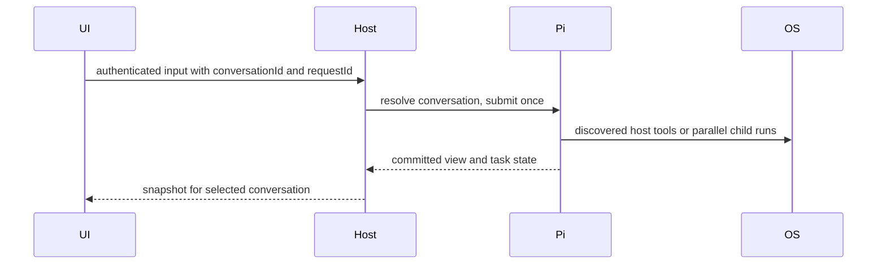

> Historical implementation record. Current setup and layout are in the root README and docs/MONOREPO.md.

# Pi VM control and progressive discovery

Arena chose A, 4.85/5, over B, 3.85/5. Keep one native Pi Durable1.3 Harness and SQLite. Adopt B's completion-cost measurements and process-group cancellation test. The selection used native fit30%, VM authority20%, token efficiency25%, persistence15%, verification10%. Do not add a second scheduler or conversation database.

## Product and owners

The owner authorises this test VM's agent to read/write arbitrary host paths, run ordinary networked shell commands, use passwordless sudo, edit Pi/server/UI/config/dependencies, install extensions and restart services. Service identity remains bot. Owner web authentication remains. No per-command approval is added. Preserve native credentials, installed plugins, history, model selections and live OLED edits.

Pi owns conversations, tool tasks, durable workflows and usage. The HTTP adapter resolves IDs and exposes native state. The browser owns selected ID and drafts only. Switching never aborts other work. The host owns authenticated artefacts and ordinary OS execution.



## Stable HTTP contracts for implementation lanes

Existing /api/state, /api/chat, /api/model and /api/abort accept optional conversationId, state via query, mutations via JSON. Omitted ID retains the old root. State returns existing shape plus conversations, selectedConversationId, workers, usage. Conversation rows are {id,title,modelId?,provider?,running?,group?,archived?}. Workers are {id,conversationId,modelId?,provider?,status,task?,result?,error?}. GET /api/conversations returns {conversations,rootId}; POST accepts {title?,modelId?,provider?,thinking?} and returns {conversation:{id,title}}. POST /api/conversations/fork accepts {conversationId,entryId}. POST /api/conversations/organise accepts {conversationId,title?,group?,archived?}, changes only the given fields of a top-level chat (group "" is ungrouped, at most 60 characters) and returns {conversation:row}; workers and side chats are refused. The filing is the native mars.conversation-organise document; an untitled chat is named once from its first message. POST /api/conversations clamps thinking to the chosen model's supported levels. POST /api/workers/stop accepts {conversationId,workerId}. Usage is optional native data, never invented costs. GET /api/artefacts/:id authenticates then serves immutable output. UI must tolerate missing new fields during deployment.

GET /api/host/version (owner auth) returns {commit,subject,deployedAt,source,repoHead,behind,interrupted,latestDeploy}. commit and subject come from deployed.json, which the deploy watchdog writes into the live app folder once a deploy is healthy (older installs fall back to the newest finished deploy). repoHead is the checkout's main and behind is git rev-list --count live..main, null when either is unknown; git results are cached for 30 seconds. interrupted is true when the latest deploy stopped without a final status (its process is gone, it never wrote a status, or it stalled), and latestDeploy {id,status,detail,at,commit} is set when the latest deploy was interrupted, rolled back or failed to apply, otherwise null. host_deploy_status reports the same interrupted status, and host_deploy refuses only while another deploy is genuinely still running.

## Implementation lanes

1. VM: own packages/pi-host/vm-control.mjs, artefacts.mjs, related check-vm-control.mjs. Export createVmControl({root,cwd}) returning {extension,artefacts}. Native unrestricted execution, bounded outputs persisted with range/search retrieval. Deferred tools host_exec/read/write, artefact_read/search, host_job start/status/stop if feasible. Avoid server modifications. Test real root0, absolute paths, networking, bounded outputs and process-group abort.
2. Native conversations: own packages/pi-host/conversations.mjs, orchestration.mjs and check-orchestration.mjs. Export createConversationManager({harness,root,context,defaultAgent}) with list/create/resolve/state/fork and createOrchestrationExtension({models,maxConcurrent}) with real native task-owned selected-model child runs. Use installed SDK types. Return compact results and independent concurrent runs, durable workflow where native tasks fit. No server modifications.
3. UI: own components/live-workspace.tsx/css, lib/pi/live-state.ts, new worker component and UI tests only. Functional new chat/list/switch, selected-ID routing, worker status/cancel, compact usage, preserve ThemeSettings/OLED. Use stable contracts above. No shared backend files.

Integrator owns server.mjs, HOST-GUIDE.md, units, SDK codemode/search installation, migration and operational verification. Model-facing tools initially only codemode and tool_search. All host/extension tools discoverable. Codemode inlineBudget700 refers to declarations, not output. Native tool_search takes no factory options, so limit3 explicitly or wrap its registration. Reset discovered tools on demand to avoid accumulation. Large outputs persist as artefacts, queried by range/text instead of context dumps. No vector-RAG claim for lexical search.

## Acceptance

Authenticated owner routes and both OAuth flows survive. Existing history/models/plugins survive. Agent executes sudo, network, absolute filesystem and host source operations. New chats remain distinct after restart. Two real model workers overlap and can be cancelled. Durable work checkpoints resume without blindly repeating unsafe shell effects. Browser new-chat and selection work. Measure initial tool declaration bytes at10/100/1000 catalogue sizes and repeated discovery, plus actual usage when provider reports it. Typecheck/lint/unit/browser/build checks report real outcomes. Do not claim a token saving from estimated schema bytes alone.


## Verified on Bot Box, 20 October 2026

| Lane | Result | Evidence |
|---|---|---|
| VM and retrieval | PASS | Actual bot uid1000, sudo uid0, outbound HTTPS200, arbitrary files, 200KB bounded output with range/search, process-group cancellation |
| Native conversations/workers | PASS | SQLite chats/forks, 105-chat pagination without transcript reads, real Sol/Luna overlap, followups, ownership, cancellation and restart checkpoints |
| Frontend | PASS | Typecheck, lint, 15 units, browser fixtures, actual authenticated browser new chat/switch, Mock Discord UI, Claude/OLED controls |
| Integration | PASS with provider issue | Clean production build, service SIGKILL recovery, persisted credentials/models/plugins and fresh mock tool invocation |

Arena reports and private run evidence are in the Bot Box trial evidence directory,
under arena-control. They contain no committed credentials. Executable checks:

```sh
node packages/pi-host/check-vm-control.mjs
node packages/pi-host/check-model-budget.mjs
node packages/pi-host/check-discovery.mjs
node packages/pi-host/check-orchestration.mjs
node packages/pi-host/check-crash.mjs
node packages/pi-host/check-extension-workflow.mjs
node packages/pi-host/check-reserved-tools.mjs
npm run typecheck
npm run lint
npm test
npm run test:ui
MARS_BUILD_CHECK=1 npm run build
```

The opt-in `MARS_LIVE_HOST_CHECK=1 node tests/live-host-check.mjs` reads the private
Bot Box owner token without printing it, creates one empty native chat and checks
the actual authenticated UI. It is not part of the fixture suite.

A live Luna parent invoked code mode, sudo/host/network checks and two workers.
Sol used gpt-6.1-sol and Luna used gpt-6-luna. Starts were four milliseconds apart;
responses took7301ms and4195ms, so model requests overlapped. Native reported
usage was5382 total tokens across parent and both children. Each child started
with about1074 input tokens. Native usage is counted once; SDK price estimates
are not a billing statement. No before/after completion-cost saving is claimed.

Initial schema size stayed2362 bytes with two offered tools for catalogues of10,
100 and1000 tools. Deferred declarations stayed absent from the prompt. When
non-deferred declarations were deliberately introduced, the native inline budget
bounded their section at2902 bytes for100 and1000. Twenty searches loaded20
schemas, demonstrating why discovery_reset exists. These are schema byte and
local timing measurements, not measured provider token savings or p95 model cost.

The historical root retained its Opus5.5 selection and77 original entries. An
operator recovery proof added one passive entry. Both native sign-ins survived.
Mock Discord kept hash77e09d9d40b0556ea13ba212c0bf9a40d9863b70f21fc4968327e2315b2b4144,
rendered after restart and ran a fresh native tool call. A background systemd
job and a native recovery task survived actual host SIGKILL. A separate disposable
SQLite/codemode test proved completed reads were reused and an interrupted unsafe
shell side effect was not repeated. No live Discord messages or external service
deployment occurred.

The first production build failed inside webpack WasmHash. After moving the old
generated build cache aside, a clean build passed. The prior live OLED edit had
removed Claude sign-in controls; they were restored while keeping OLED. Browser
verification caught a mobile drawer inheriting centred dialog translation; the
shared dialog now selects left placement explicitly, and the mobile test passes.

## Limits and provider blocker

Opus5.5 successfully executed code mode, a systemd job, an arbitrary host write
and a host source read. Anthropic then returned a provider-side cyber-content
restriction for its final response. That request ended unanswered with model_error.
VM permissions were available and the local effects completed. Provider content
policies are outside this host's control. The blocked request was not retried.

Retrieval is lexical search/range access, not a vector database. The sidebar shows
a bounded latest page plus root; older native chats have cursor pagination through
the API. Native model dispatch defaults to four concurrent requests and8192 output
tokens each, configurable by service environment. There is no whole-run billing
cap, and shell-launched model clients do not pass through this adapter. Tool-search
schemas persist until reset. Independent OS jobs use existing systemd-run,
status and cancellation commands rather than a second scheduler. Long jobs need
--no-block when the launch should return immediately.

Native workflow names should include their compatibility version. Replacement
packages must retain task definitions needed by unfinished work. The native SDK
resolves one definition per name; arbitrary incompatible task migrations are not
automatically solved by immutable package hashes. Host code and dependencies are
ordinary editable source and use systemd restarts, while installed extension
replacements and Next UI edits can apply live.

## Queue and steer

Pi's native inbox (`pi.inbox`, returned in `view.docs`) is the only queue. While a reply runs, POST /api/chat
accepts `mode`: `"queue"` (default) submits with `whenBusy: "followUp"`, so the message waits for the reply to end;
`"steer"` submits with `whenBusy: "steer"`, so Pi places it at the running reply's next tool boundary.
POST /api/queue/steer `{conversationId, submissionId}` withdraws a queued followUp and resubmits the same content and
entry as a steer; POST /api/queue/remove withdraws it. Both refuse ids that are no longer queued. POST /api/abort keeps
queued messages: they are read, the run is aborted (which withdraws them), and they are resubmitted in order, so the
first starts the next reply. The composer shows the queue above the input with Steer and remove per message; Enter
queues, the Steer button (or Ctrl/Cmd+Shift+Enter) steers. The assistant-ui queue adapter is attached only while a reply
runs and keeps no copy of the queue.
