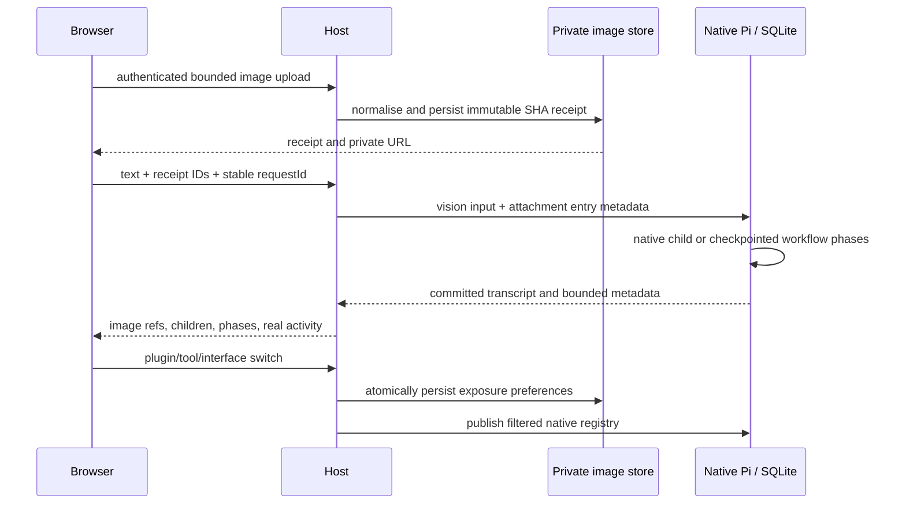

# Images and native subthreads

## Product rule

Ctrl/Cmd+V, file selection and drag/drop attach images to the composer. Show a
small preview, filename, upload/failure state and Remove before sending. Allow
image-only messages. Sent messages show private thumbnails with image references
that survive refresh and host restart. Support PNG/JPEG/WebP/GIF input, normalise
static model images, bound bytes/dimensions and reject malformed or unsupported
files. Never embed image base64 in repeatedly polled browser snapshots.

Use assistant-ui's attachment adapter and composer, preserving Markdown, IME,
drafts, model selection and explicit cancellation. Keep the incumbent Claude-like
dark/OLED UI. Subthreads are real native task-owned conversations. Show concise
named child task cards and indented sidebar children. A child opens its own
transcript/composer, with Back to parent, actual status and explicit Stop.
Switching never cancels a parent or child. Refresh uses URL conversation selection.

Pi owns transcript/ownership/status/usage. A native title doc owns names. The host
owns immutable private image files and upload receipts. The browser owns drafts
and selected conversationId. Images enter the selected native message once.
Worker inputs may explicitly reference attachment IDs; do not copy the parent's
images or transcript into every child. The model sees compact attachment reference
text plus actual native image blocks. Stored entry data owns browser image refs.

## Integration contract

POST /api/attachments accepts a raw image body, content-type image/* and encoded
filename in x-file-name. Max input10MiB, max4 images per message. Return
{attachment:{id,name,mimeType,size,width,height,url}}. ID is lowercase SHA256,
url is /api/attachments/ID. GET that URL authenticates owner before serving the
normalised image. The Mac development proxy forwards this exact binary route
with size bound and existing owner/origin rules, while other POSTs remain JSON.
POST /api/chat accepts {conversationId,text,requestId,attachmentIds?:string[]}.
Native submission uses entry {kind:'mars.user',data:{attachments:[receipts]}} with
content [text and native {type:'image',data,mimeType} parts]. Request ID deduplicates
submission. Selected non-vision models fail clearly before creating a run.

/api/state preserves existing shape, adds parentConversationId?:string,
conversationTitle?:string, and subthreads?:[{id,conversationId,title,provider,
modelId,status,parentEntryId?}]. conversationId on a subthread row means parent,
id means child. Workers also include title, task and parentEntryId where known.
Conversations rows remain parent chats only; subthreads are a bounded child list
for those parents. Deep children have parent links. Both /api/state and chat/model/
abort resolve selected child IDs through native ownership, not a second database.
Browser snapshot entries retain image refs in entry.data.attachments and strip
native base64 image data before sending. Message image parts can be mapped to
same-origin attachment references. Child creation stores title/task metadata in a
native latest doc during the existing workflow prepare commit. worker_run/fanout
jobs accept title? and attachmentIds? so an agent can define named tasks and
explicitly pass images. Existing checkpointed tasks remain compatible.

## Lanes

Image worker owns packages/pi-host/image-store.mjs and check-image-store.mjs only.
Export createImageStore({root}) with add(bytes,{mimeType,name}), get(id),
content(ids,text) returning native blocks plus receipts, and browserView(view)
removing model image bytes using stored entry receipts. Root owns server routes,
proxy and dependencies. Return exact APIs early.

Thread worker owns conversations.mjs, orchestration.mjs and check-subthreads.mjs
only. Export listSubthreads, selectedThread metadata or manager equivalents.
Keep existing manager APIs, add resolve child support, native title metadata,
model-visible worker title/image references, and native ownership validation.
Inject image loading function in orchestration factory from root, no image-store
imports. Root integrates selected state/HTTP routes. Metadata lists stay bounded
and never load every transcript. Test existing orchestration compatibility.

UI worker owns live-workspace.tsx/css, live-workers.tsx, lib/pi/live-state.ts,
new image-attachment adapter/UI components and UI/unit tests only. Use native
assistant-ui AttachmentAdapter. Work from this contract, tolerate absent fields
while deploying. No backend/proxy/dependency changes. Preserve current theme and
Claude settings. Native data must drive cards and nesting. Root integrates/tests.

## Acceptance

Paste an actual image through browser clipboard events, preview/remove, send once
with caption or image only, reload and restart with receipt unchanged. Confirm a
real vision request recognises supplied content. Invalid/oversized/wrong MIME
uploads and unauthenticated retrieval fail. Snapshot sizes do not scale with image
base64. A four-task mock run shows eggs/tomatoes/ham/cheese as separate real child
threads, opens them and accepts a followup, survives restart and never sends any
external messages. The live Pi consumes the supplied screenshots, authors and
installs a small local extension with UI, and its post-restart tool/UI proof is
reported separately from operator-implemented infrastructure. Preserve original
existing Pi credentials, conversations, installed plugins and local edits. Run unit,
HTTP/native, desktop/mobile browser, lint, typecheck and clean build checks.

## Ordered workflows, added from the second reference

Workflows are separate from independent subthreads. Agent-defined workflow_start
accepts {title,steps:[{title,prompt,model?,provider?,modelId?,attachmentIds?}]}.
It returns immediately with workflowId. Native defineTask persists ordered phases;
step N receives only step N-1's bounded output plus its own brief. Default models
are economical Luna unless selected explicitly. Each step is a real native child
conversation, opens as a subthread, and records status, start/end/duration and
native reported token usage. Workflow rows are separate from worker cards.

GET /api/workflows?conversationId=ID returns {workflows:[{id,conversationId,title,
status,currentStep,startedAt?,finishedAt?,steps:[{index,title,status,conversationId?,
provider?,modelId?,startedAt?,finishedAt?,durationMs?,usage?,result?}]}]}.
Same workflows array may be in /api/state for the selected parent. POST
/api/workflows/stop {conversationId,workflowId} explicitly aborts native task and
its owned active step. Collapse phases by default, show compact clickable
workflow card and an expandable phase view, reachable from a quiet Workflows
control. Parent chat stays usable while background work runs. Commit one passive
parent completion entry with stable native ownership, not a new paid model call.
Stopping the parent response does not stop background workflow; stopping workflow
does. A blocked/failed/aborted step prevents later step launches. Do not fabricate
token totals or hidden reasoning. Test three ordered steps, data handoff,
background response return, restart midphase and explicit cancellation.

Integrator owns new workflows.mjs and check-workflows.mjs. Thread worker should
support task-owned children generically and read a shared metadata doc export so
workflow children are titled. UI worker should consume optional workflows rows
and style phases in the same incumbent system, no permanent runtime sidebar.

## Activity and plugin management, added from latest references

Show a compact ChatGPT-style activity timeline: collapsed groups of actual
commands, file actions and tool calls, with live Thinking/Working status and real
agent start/finish states. Expand to inspect evidence. Counts and file-change
statistics appear only when native results supply them. Preserve assistant
status text between action groups. Ignore a Sources panel for this delivery.
A codemode call is listed as the nested calls it made; when the script itself failed
or was stopped, its own row follows them with its error, and it counts as failed. A
failed or stopped edit or write shows its error, never the diff it tried.

Extension management is catalogue-driven. Render installed extension cards with
name, description/version, enabled switch, Open interface and Manage controls.
Manage lists actual tool names/descriptions with per-tool switches and optional
UI enable switch. Turning off hides discovery/callability for future calls, not
just the card. Running native calls may finish under their captured definitions.
Retain native task definitions while disabled so durable work stays recoverable.
No plugin UI mounts automatically in every conversation. MCP-wrapped extensions
use this same registry interface; a fabricated MCP connector is not a connection.

Integrator will install createPluginRegistry({root}) => {registry,list,set,isUiEnabled}
from new plugin-registry.mjs. registry implements native install/uninstall/snapshot/
subscribe and retains original definitions while applying persisted exposure
settings. list() returns [{name,title,description,version?,kind:'extension'|'system'|'mcp',
enabled,uiEnabled,hasUi,tools:[{name,description,enabled}]}]. registry.install(ext)
accepts optional metadata on ext.marsPlugin={title,description,version,kind,hasUi}.
No metadata means kind system, humanised extension name and no UI. Installed
package loader adds marsPlugin from manifest to native object before registering.
Settings alone persist, definitions come from core/installed packages each boot.
set({name,enabled?,uiEnabled?,tools?:Record<string,boolean>}) serialises writes and
returns updated row. Unknown plugin/tool fails. Owner auth stays at HTTP boundary.
Plugin toggles control tool exposure, not hostile-code isolation or root authority.

GET /api/plugins => {plugins:rows}. POST /api/plugins same set body => {plugin:row}.
Snapshots omit the full plugin catalogue; the Extensions page fetches it explicitly.
Snapshots retain existing extensions catalogue rows for UI
hashes, enriched enabled/uiEnabled states. Disabled/UI-off plugin modules are not
served or mounted. UI reads plugin cards dynamically, with installed packages
first and system capabilities behind a disclosure. Runtime pages/core feature
controls stay quiet. Agent tools plugin_list and plugin_configure use same native
manager, so the agent can define/install/manage plugins without hardcoded names.

## State and event order

The catalogue and native definitions own plugin metadata. One serialized settings
writer persists preferences before registry notification. Already captured calls
finish; disabled task definitions remain available for recovery. Workflow phase
conversations stay out of independent worker/subthread lists and open from phases.
Parent pagination skips owned children using metadata only, without transcript loads.
