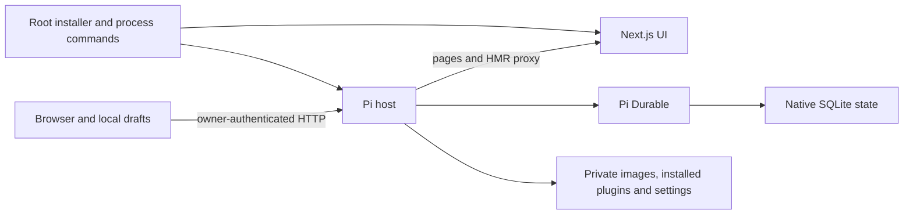

# Architecture

Mars has two packages. apps/ui contains the Next.js client. packages/pi-host
contains the custom Pi Durable adapter and pinned upstream native SDK dependency.

The browser owns only unsubmitted drafts, selected conversation ID and visual
preferences. Pi owns admitted input, conversations, child ownership, tasks,
checkpoints and usage. The host authenticates requests and routes each accepted
input once using requestId. Plugin preferences have one atomic writer and publish
filtered native definitions only after persistence. Workflow phases store their
state natively, and pass only the preceding bounded result to the next phase.

Images are immutable normalised private files. Native entry metadata stores
receipts, model input carries the bytes, and browser polls contain only references.
Children receive images only when their brief explicitly includes attachment IDs.
Browser detachment does not abort a native run. Explicit Stop does.

The two workspaces do not import each other's implementation. HTTP is the boundary.
The root boundary check enforces the declared imports in architecture-policy.json.
Host tools may edit either workspace as authorised VM operations; this is a file
operation, not a cross-workspace module dependency.

Deployment stages a committed candidate, installs its locked host dependencies,
runs native checks and an isolated boot, then switches with a rollback watchdog.
One process owns the live native database. Runtime data and credential stores stay
outside the checkout. A code replacement must not replace or clone those stores.
