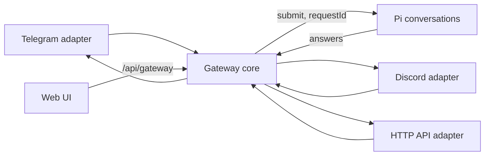

# Gateway: one Mars, many clients

Status: spec for the codex/gateway-sweep branch. Research behind each decision is in
`docs/research/gateway-designs.md`, `docs/research/telegram-discord.md` and the ADRs in
`.agents/DECISIONS.md` ("Gateway" entries).

## What it is for

Mars is one persistent agent with many conversations (Pi owns them). The gateway lets the
owner reach those conversations from other clients: Telegram, Discord and a plain HTTP
API, as well as the web UI. A conversation started in Telegram shows in the web UI's
Recents and can be continued there, then continued again from Telegram. A message to a
busy conversation waits its turn and never interrupts other conversations or tasks.

## Parts



- **Gateway core** (`packages/pi-host/gateway/core.mjs`): routing, access, commands,
  idempotent admission, outbound delivery and chunking. One per host. It never imports
  a platform library.
- **Adapters** (`packages/pi-host/gateway/adapters/*.mjs`): one per platform. They turn
  platform events into `InboundEvent`s and send text back. Nothing else.
- **State**: Pi documents only (session scope), so there is no second database:
  - `mars.gateway` holds bindings, the owner allowlist, pending pairings and the
    outbound delivery queue.
  - `mars.gateway-audit` holds the latest 500 audit records.
  - Each bound conversation has `mars.channel` (conversation scope) naming its channel,
    for the Recents badge.

## Adapter contract

```js
/** @typedef {{ channel: string, account: string, eventId: string,
 *   sender: { id: string, name?: string }, chat: { id: string, type: 'dm'|'group' },
 *   thread?: string, text: string, at?: number }} InboundEvent */
adapter = {
  channel: 'telegram',            // stable name, also the route key prefix
  limits: { maxText: 4096 },      // the chunker splits replies to this
  start(sink, signal),            // begin receiving; call sink(event) for each message,
                                  // and only acknowledge the platform after sink resolves
  send({ chat, thread, text }),   // deliver one chunk; resolves { messageId } or throws
                                  // an Error with .retryAfterMs (rate limit) or .permanent
  health(),                       // { state: 'running'|'starting'|'stopped'|'failed', detail? }
}
```

The host owns the lifecycle. `start` runs inside a supervisor: if it throws or rejects,
the gateway records the failure, marks the adapter `failed` and restarts it with backoff
(1 s doubling to 60 s). An adapter can never stop Pi, the HTTP server or another adapter.

## Routing

- Route key: `<channel>:<account>:<chatType>:<chatId>[:thread:<threadId>]`, built by one
  function, `routeKey(event)`. Each chat is its own route; Discord and Telegram never share
  a route by accident.
- A **binding** maps a route key to a Pi conversation id. The first owner message on an
  unbound route creates a new top-level conversation titled from the message, binds it,
  and records `mars.channel` on it.
- The web UI is not a route: it opens conversations by id. A conversation bound to
  Telegram is an ordinary conversation, so the web UI can read and continue it. Replies to
  web UI messages in a bound conversation are also sent to the bound chat, so the chat
  stays a complete view of the conversation (see Delivery).

## Access and pairing

- Only the **sender id** is checked, never the chat id, so a group cannot let strangers in.
- Allowed senders are the owner's own accounts, listed per channel in `mars.gateway`.
- An unknown sender's text never reaches Pi. They receive one reply with an 8-character
  pairing code (no ambiguous letters). Codes expire after 1 hour; at most 3 are pending
  per channel; a repeat message from the same sender reuses their pending code.
- The owner approves or rejects a code in the web UI (Connections, Gateway). Approval adds
  that sender id to the allowlist. Mars has full VM control, so the UI says plainly that
  approving gives the sender the same power as the owner.
- Every inbound event gets an audit record: time, channel, sender, route, decision
  (`accepted`, `duplicate`, `paired`, `denied`, `command`), conversation id. Message text is
  not stored in the audit log; Pi already has it for accepted messages.

## Admission and busy conversations

- Each accepted message is submitted to its conversation with
  `requestId = "gw:" + channel + ":" + account + ":" + eventId`. Pi stores request ids per
  conversation and returns the existing submission for a repeat, so a redelivered event
  never submits twice, including after a restart.
- The gateway also records accepted event keys in `mars.gateway` (latest 2000) so a repeat
  is recognised before routing, for example after `/new` rebinds the chat. A repeat is
  audited as `duplicate` and acknowledged without a reply.
- Messages to a busy conversation use Pi's default `whenBusy: "followUp"`: they queue in
  that conversation's inbox and run after the current answer, in order. They never touch
  any other conversation. `/steer <text>` is explicit and uses `whenBusy: "steer"`.

## Commands

Commands start with `/` and are handled by the gateway, not the model. They bypass the
busy queue.

| Command | Effect |
| --- | --- |
| `/new [title]` | Create a new conversation and bind this chat to it. |
| `/sessions` | List the 10 most recent conversations with a number each. |
| `/switch <n or id>` | Bind this chat to that conversation (from `/sessions`, or any id). |
| `/status` | This chat's conversation: title, running or idle, queued messages, running workers. |
| `/stop` | Stop the running answer in this chat's conversation. |
| `/steer <text>` | Send text into the running answer instead of queueing it. |
| `/help` | List the commands. |

## Delivery

- When a submission settles, the gateway reads the answer entry and delivers its text to
  every route bound to that conversation, in order.
- Replies go through one chunker: split at paragraph, line, sentence, then space, then
  hard; never inside a code fence (a fence split across chunks is closed and reopened).
- Each chunk is a delivery job in `mars.gateway.outbox` with an id, so a restart resumes
  unsent chunks. Rate limits wait `retryAfterMs` and retry; a permanent error (403, chat
  not found) drops the job and records `delivery_failed` in the audit log. Delivery is at
  least once: a crash between send and record can repeat one chunk.
- While a conversation is answering, adapters that support it show a typing indicator.
  Edit-in-place streaming is not in v1.

## HTTP API adapter

Owner-authenticated, like every `/api` route:

- `POST /api/gateway/api/messages {chatId, eventId, text}` submits as channel `api`.
  Replies are collected in an outbox the caller reads with
  `GET /api/gateway/api/messages?chatId=...&after=<seq>`.
- `GET /api/gateway` returns adapters with health, bindings with conversation titles,
  pending pairings and the latest audit records.
- `POST /api/gateway/pairings {code, approve}` approves or rejects a pairing.
- `POST /api/gateway/bindings/delete {route}` unbinds a chat.

## Telegram and Discord adapters

No new dependencies (research ADR): Telegram uses `fetch` long polling of `getUpdates`
(timeout 25 s, offset acknowledgement after the sink resolves); Discord uses Node's
built-in `WebSocket` for the Gateway (identify, heartbeat, resume) and `fetch` for REST.
Both read their tokens from Settings (`connections.json`) or the environment
(`MARS_TELEGRAM_TOKEN`, Discord's existing bot token). Owner sender ids come from
`MARS_TELEGRAM_OWNER` and `MARS_DISCORD_OWNER` or from pairing. Base URLs are injectable
so tests run against fake platform servers. An adapter without a token is listed as
`stopped` with "Add a token in Settings".

## Agent tools

- `gateway_status {}`: adapters, bindings and pending pairings, so the agent can answer
  "is Telegram connected?".

## What it does not do (v1)

- No edit-in-place streaming, attachments or voice from chat platforms.
- No per-user tool permissions: only the owner (and senders they approve) are allowed.
- No webhook mode for Telegram (the host binds loopback only).

## Acceptance

`packages/pi-host/check-gateway*.mjs`, on a real Pi harness with a scripted model and
fake platform servers:

1. Start a conversation from fake Telegram, see it in the conversation list with its
   channel, continue it through the web API, continue again from Telegram; every reply
   reaches the chat.
2. A redelivered event submits once, before and after a restart.
3. A message to a busy conversation queues and runs after; another conversation's run is
   untouched.
4. Bindings, pending pairings and unsent deliveries survive a restart.
5. Unknown sender gets a code, nothing reaches Pi; approval lets them in; every event is
   audited.
6. Fake platforms cover message, edit, duplicate delivery, rate limit (429), reconnect and
   permission denial (403).
